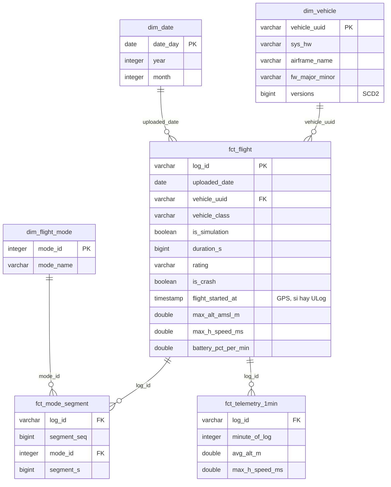

# Guion de la presentación (~7 min)

Prototipo: **lakehouse de logs de vuelo PX4** con Docker, una API externa, Iceberg/Trino y dashboards.
Cada bloque responde a uno de los puntos que pide la actividad.

| # | Bloque (actividad) | Tiempo | En pantalla |
| --- | --- | --- | --- |
| 1 | La problemática | 0:45 | README (título) |
| 2 | La API y los datos | 1:00 | `docs/reports/dbinfo_profile.md` |
| 3 | Arquitectura y contenedores | 1:30 | Diagrama del README + `make ps` |
| 4 | Diseño de la base de datos | 1:30 | Diagrama de abajo + Lakekeeper UI |
| 5 | Demostración en vivo | 2:00 | Airflow → RustFS → Trino → dashboard |
| 6 | Cierre | 0:15 | `DECISIONS.md` |

---

## 1. La problemática (0:45)

> PX4 es el autopiloto de código abierto más usado en drones. Miles de pilotos suben sus logs de vuelo a un sitio público, Flight Review. La pregunta es: **¿cómo se usa y qué tan confiable es la flota PX4 en el mundo real?** ¿Qué tipos de vehículo vuelan más, en qué modos, con qué firmware, y cuáles reportan fallas?

- Hoy esa información existe, pero dispersa en ~477 mil registros y en archivos binarios.
- El prototipo la convierte en tablas consultables y dashboards que se actualizan solos.

## 2. La API y el tipo de información (1:00)

- **Índice:** `GET https://review.px4.io/dbinfo`. Es **un solo archivo** JSON comprimido (~32 MB), con **477 mil logs** desde 2016 y ~590 nuevos por día.
  - Trae 26 campos por vuelo: tipo de vehículo, duración, modos de vuelo, errores, firmware, hardware.
  - El servidor lo regenera una vez al día y responde **304 Not Modified** si no cambió: lo usamos para no descargar de más.
- **Telemetría:** cada vuelo tiene un archivo binario **ULog** (~18 MB en promedio) con posición, altitud, velocidad, batería y mensajes del autopiloto. Se leen con `pyulog` y se resumen a 1 segundo.
- **Datos "sucios" reales** (de ahí el valor de la capa silver):
  - `wind_speed = -1` significa "sin dato" (95 %).
  - Ratings basura (`BRAWO!`, `1`).
  - Duraciones imposibles: contadores de 64 bits que se desbordaron.
  - ~7 % son vuelos **simulados**.
  - El `log_date` es la fecha de **subida**, no la del vuelo.

## 3. Arquitectura y función de cada contenedor (1:30)

Mostrar el diagrama del README y `make ps`: **8 contenedores**, 6 servicios y 2 tareas que corren una vez y terminan.

- **Airflow** (1 contenedor, `airflow standalone`) **orquesta**: decide qué corre y cuándo.
  - La descarga la hace nuestro paquete `drone_ingest`, en su propio entorno.
  - Es el "contenedor que consume la API" que pide la actividad.
- **setup** corre una vez al arrancar y configura lo que una persona haría a mano en cada herramienta: buckets, reglas de expiración, el warehouse y los namespaces.
- **RustFS** es almacenamiento compatible con S3, el *data lake*: archivos crudos, tablas y reportes.
- **Iceberg + Lakekeeper:** las tablas son Parquet con metadatos Iceberg (snapshots, *time travel*). Lakekeeper es el catálogo que sabe qué archivos forman cada tabla y guarda su estado en **PostgreSQL**.
- **Trino** es el motor SQL. No guarda datos: lee y escribe las tablas Iceberg.
- **dbt** transforma con SQL bronze → silver → gold, con tests y contratos. Cada modelo es una tarea de Airflow (Cosmos).
- **dbt Charts** sirve los dashboards y publica reportes HTML/PDF.
- Todo se levanta con `make up`. Mensaje clave: **la comunicación entre contenedores es por nombre de servicio** dentro de la red de Docker (`trino:8080`, `rustfs:9000`).
- Segundo mensaje: **usamos funciones nativas en vez de código propio.** RustFS borra solo los archivos crudos después de un día (regla de *lifecycle*), y Lakekeeper guarda 7 días las tablas borradas por si hay que recuperarlas.

## 4. Diseño de la base de datos (1:30)

Arquitectura *medallion* sobre Iceberg:

| Capa | Qué contiene | Quién la escribe |
| --- | --- | --- |
| landing | Archivos tal como llegan (índice `.json.gz`, `.ulg`) | `drone_ingest` |
| bronze | Registros crudos, *append-only*, con columnas de auditoría; solo se insertan registros nuevos o cambiados (hash) | `drone_ingest` (PyIceberg) |
| silver | Datos limpios y tipados, dimensiones y hechos; historial de vehículos (SCD tipo 2) | dbt |
| gold | 9 *marts* con contrato de columnas, listos para dashboards | dbt |

El centro del modelo es `fct_flight`, un registro por vuelo:



En la Lakekeeper UI (http://localhost:8181/ui/): warehouse `px4` → namespaces `bronze/silver/gold/audit` → una tabla → **Preview**. Ese DuckDB corre *en el navegador* y lee el Parquet directo de RustFS.

## 5. Demostración en vivo (2:00)

Preparado antes de clase: stack arriba con datos (ver checklist), `px4_transform` activo y estas pestañas abiertas.

1. **Obtención:** en Airflow (http://localhost:8080) disparar `px4_ingest_daily` con `{"max_ulogs": 5}`.
   - Mostrar el grafo: `snapshot_index` responde 304 o descarga, y las tareas mapeadas `fetch_ulogs[...]` / `parse_ulogs[...]`.
2. **Almacenamiento:** en la consola de RustFS (http://localhost:9001/rustfs/console/), el bucket `landing/px4/ulog/log_date=…/` con los `.ulg` recién bajados.
3. **Consulta:** en una terminal:
   ```bash
   make trino SQL="SELECT vehicle_class, sum(logs) AS logs, round(sum(flight_hours)) AS horas FROM gold.mart_flights_by_class_month GROUP BY 1 ORDER BY 2 DESC"
   ```
4. **Integración automática:** al terminar la ingesta, `px4_transform` arranca solo (asset-triggered). Mostrar las tareas `silver.stg_logs.run` / `.test` y, al final, `upload_reports`.
5. **Visualización:** http://localhost:8088/fleet_overview/
   - Cambiar el filtro de clase de vehículo.
   - Luego `reliability`: 19.6 % de los logs tienen un error registrado por PX4.
6. **Funciones nativas (si sobra tiempo):**
   - `make lifecycle`: las reglas con las que RustFS expira `landing/px4/ulog/` en 1 día, sin ninguna tarea de limpieza.
   - Borrar una tabla "por accidente" y recuperarla:
     ```bash
     make trino SQL="DROP TABLE gold.mart_flight_envelope"
     ```
     En la Lakekeeper UI: `px4` → `gold` → pestaña **Deleted** → *Restore*. Luego `make trino SQL="SELECT count(*) FROM gold.mart_flight_envelope"`.
   - En la misma UI, la pestaña **Versioning** de una tabla gold: cada corrida de dbt es un *snapshot* nuevo de la misma tabla (*time travel*).

Si algo tarda, mientras corre: explicar que el *test* de dbt detiene la publicación si un dato viene mal (contratos + tests).

## 6. Cierre (0:15)

> Todo el flujo, de la API al dashboard, es reproducible desde cero con `make up` y un *smoke test* automático. Las decisiones y los problemas reales que encontramos están documentados en `DECISIONS.md` y `CLAUDE.md`.

---

## Checklist antes de clase

- [ ] Docker Desktop corriendo (no *paused*), con ≥ 8 GB de RAM.
- [ ] `make up` sin errores; `make ps` con 8 contenedores: 6 `healthy` y `setup` + `lakekeeper-migrate` en `Exited (0)`.
- [ ] `PX4_MAX_ULOGS_PER_RUN` fijado en `.env`.
- [ ] `px4_transform` **activo**. Los demás DAGs pausados, para disparar `px4_ingest_daily` a mano.
- [ ] Un `make airflow ARGS="dags trigger px4_transform"` reciente y en verde, para que los dashboards tengan datos frescos.
- [ ] `make charts-check` → los 4 tableros `OK`.
- [ ] `make slides`: las 4 diapositivas con números en vivo (pie de página "Datos en vivo"). Sin el stack muestran el último snapshot.
- [ ] `make portal`: la página de inicio con todos los enlaces, con las 5 interfaces en verde (*reachable*).
- [ ] Pestañas abiertas: Airflow, consola RustFS, Lakekeeper UI, dashboard; terminal en la raíz del repo.
- [ ] Si se hace la demo de borrar y recuperar: después de *Restore*, confirmar que `make charts-check` sigue en `OK`.
- [ ] Copia del plan B (abajo) en el escritorio.

## Plan B (sin red o si algo falla)

- **Sin internet:** la ingesta necesita la API, todo lo demás es local.
  - Saltar el paso 1 y disparar directamente `px4_transform` (`make airflow ARGS="dags trigger px4_transform"`). Corre dbt, valida, renderiza y sube los reportes solo con los datos ya cargados.
- **Si el stack no levanta:** abrir los reportes ya generados en [`plan_b/`](plan_b/) (PDF y HTML de los 4 tableros) y los resultados de consultas en [`plan_b/consultas.md`](plan_b/consultas.md).
- **Si un dashboard falla en vivo:** `make dct ARGS="render charts/fleet_overview.yml --format text"` muestra en la terminal los mismos números que el dashboard.
